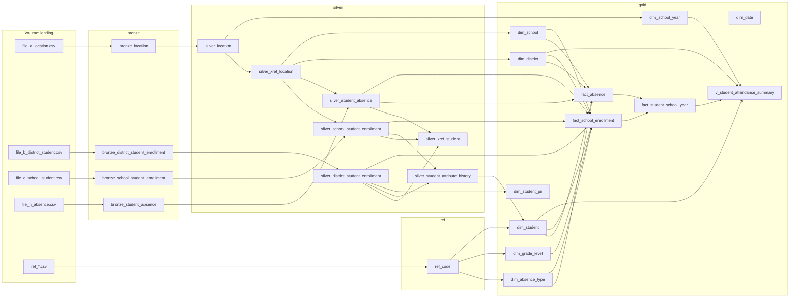

# Lineage demo

`cedars_lineage_demo.py` is a Databricks notebook that builds a small, runnable slice of the warehouse: Files A, B, C
and N, from a landing volume through bronze and silver to gold. It loads mock data so Unity Catalog records real
lineage. This file explains what the lineage graph should look like once the notebook has run.

## Run it

1. Import the notebook into a workspace: Workspace → Import → choose the file. The `# Databricks notebook source`
   header makes it import as a notebook.
2. Attach it to Unity Catalog compute. Any of these works: serverless, a cluster in Standard or Dedicated access mode,
   or a SQL warehouse for the SQL cells.
3. Check the `catalog` and `schema` widgets (defaults: `ofmp20w_sandbox_catalog_dev` and `andrewweller`), then
   choose **Run all**.
   - Everything goes into that one schema. The medallion layer is a table-name prefix (`bronze_`, `silver_`, `ref_`,
     `gold_`) instead of a separate schema, and the mock files land in a volume named `landing`.
   - Every demo table is created with `CREATE OR REPLACE`. The notebook refuses to run if `bronze_location` already
     exists in the schema and wasn't created by this notebook.
4. After a few minutes, open any gold table in Catalog Explorer and go to **Lineage** → **See lineage graph**.

The notebook can be rerun. The last cell (commented out) drops only the demo tables, view and volume, and leaves the schema alone.

## What gets built

`dim_date` has no incoming edges because it is generated from `sequence()` rather than read from a table. It also
has no outgoing edges: lineage comes from queries, not from declared foreign keys, and no load query reads
`dim_date`. Facts store `YYYYMMDD` date keys without joining to it.

## Column lineage worth clicking through

In the lineage graph, expand a table and click a column. These four show the most.

| Gold column | Expected upstream path | What it shows |
|---|---|---|
| `gold_fact_school_enrollment.school_sk` | `gold_dim_school.school_sk` ← `silver_xref_location.school_code` ← `silver_location.school_code` ← `bronze_location.SchoolCode` ← `file_a_location.csv` | The school comes from **File A**, not File C. It resolves through the crosswalk (design §5.4). Join keys such as `bronze_school_student_enrollment.LocationId` may also appear, depending on the runtime. |
| `gold_fact_school_enrollment.enrolled_days` | `silver_school_student_enrollment.days_present` (C12) **and** the `silver_student_absence` columns behind the full-day absence count | One measure derived from two CEDARS files. The documentation trail for the design §6 approximation. |
| `gold_dim_student.gender` | `silver_student_attribute_history.attribute_value` ← `silver_district_student_enrollment.gender` **and** `.grade_level` | Column lineage is **not row-aware**. After an UNPIVOT/PIVOT, gender appears to depend on grade level too. Expect over-inclusive lineage anywhere attributes are stored as rows. |
| `gold_v_student_attendance_summary.attendance_rate` | `gold_fact_student_school_year` ← `gold_fact_school_enrollment` and `gold_fact_absence` ← silver ← bronze ← files | End-to-end lineage across six hops, through a view. This is what an analyst sees from the Tableau-facing layer. |

Also check:

- **`gold_dim_student_pii`.** B06, B07 and B09 flow only into this table. Open `silver_district_student_enrollment.legal_last_name`
  and look **downstream** to confirm no other gold table receives it. This is the governance use case.
- **`silver_xref_student`.** It has three upstream tables (B, C and N), from a `UNION ALL`.
- **`gold_dim_school`.** It is loaded by `MERGE`, and the lineage looks the same as for an `INSERT`.
- **The notebook itself.** It appears as the producing entity on each edge. With a scheduled job, the job and run
  appear instead.

## The deliberate gap

Section 6 builds the same summary twice:

- `gold_demo_absence_by_school_sql` is built with SQL. Its upstream is `fact_absence`.
- `gold_demo_absence_by_school_pandas` goes through `toPandas()` and then `createDataFrame()`. **No upstream** is
  recorded, because Unity Catalog sees a table written from local data.

The same gap appears whenever data leaves Spark and comes back. Examples are an external ETL tool writing files by
path, a CSV exported and re-imported, or a Python UDF that calls an API.

## Reading lineage programmatically

Section 7 of the notebook queries `system.access.table_lineage` and `system.access.column_lineage`. It then walks
column lineage upstream from three gold columns and prints the tree. These tables need the `system.access` schema
enabled and `SELECT` granted on it, and rows can take a while to arrive. Use them for documentation that has to be
exported, such as an attestation of where a reported number came from, or a check that nothing outside
`dim_student_pii` reads PII columns.

## What this means for the real warehouse

- **DDL alone produces no lineage.** The `sql/` DDL in this repo creates empty tables, and the graph stays empty
  until the load pipelines run, since lineage is recorded from the queries that read and write data. The design
  choices that matter for lineage live in those pipelines, which are out of scope for this pass.
- **Write loads as SQL or DataFrame operations on Unity Catalog tables.** Avoid pandas round-trips and path-based
  writes in the main pipeline, or lineage breaks at that point.
- **Column comments complement lineage.** Lineage shows *which* columns feed a target, while the `CEDARS B12`-style
  comments say *what* each column means. Both appear in Catalog Explorer.
- **Unpivoted tables blur column lineage.** `silver_student_attribute_history` is a good audit table, but anything
  pivoted out of it shows every unpivoted attribute as upstream. If precise column lineage for `dim_student`
  matters, consider building it from `silver_district_student_enrollment` directly, using the history table only to
  pick the winning row.
- **Mapping vs. lineage.** `mapping/source_to_target.csv` is the *intended* lineage. Unity Catalog lineage is the
  *observed* lineage. Once pipelines exist, a validator could compare the two, joining the mapping to
  `system.access.column_lineage` through the `CEDARS <id>` column comments.
