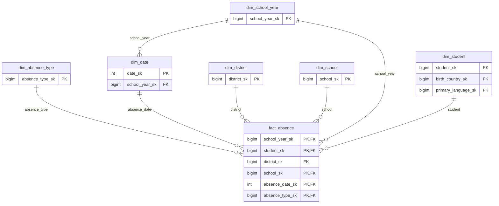
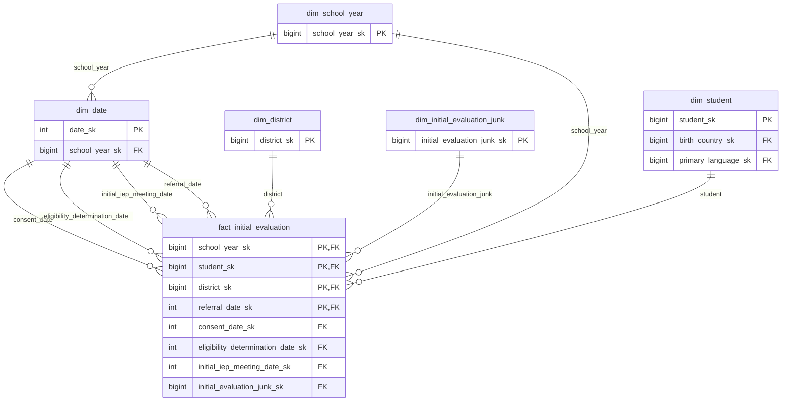

# CEDARS gold ERD

Generated by `tools/gen_ddl.py` from `tools/gold_spec.py`. One diagram per fact family: each fact with the dimensions it references, and the bridges that hang off those dimensions. Only key and foreign-key columns are shown. Standard dimensions (date, school year, district, school, student) appear in every family. Full column lists are in `sql/gold/`.

## Enrollment and student year

Facts: `fact_district_enrollment`, `fact_school_enrollment`, `fact_student_school_year`

```mermaid
erDiagram
    fact_district_enrollment {
        bigint school_year_sk PK, FK
        bigint student_sk PK, FK
        bigint district_sk PK, FK
        bigint home_district_sk FK
        int entry_date_sk PK, FK
        int exit_date_sk FK
        bigint grade_level_sk FK
        bigint student_profile_sk FK
        bigint family_language_group_sk FK
    }
    fact_school_enrollment {
        bigint school_year_sk PK, FK
        bigint student_sk PK, FK
        bigint district_sk FK
        bigint school_sk PK, FK
        int entry_date_sk PK, FK
        int exit_date_sk FK
        bigint grade_level_sk FK
        bigint enrollment_junk_sk FK
        bigint student_profile_sk FK
    }
    fact_student_school_year {
        bigint school_year_sk PK, FK
        bigint student_sk PK, FK
        bigint district_sk PK, FK
        bigint primary_school_sk FK
        bigint grade_level_sk FK
        bigint student_profile_sk FK
        bigint home_language_sk FK
        bigint family_language_group_sk FK
    }
    bridge_family_language_group {
        bigint family_language_group_sk PK, FK
        bigint language_sk PK, FK
    }
    bridge_student_ethnicity {
        bigint student_sk PK, FK
        bigint school_year_sk PK, FK
        bigint district_sk PK, FK
        bigint ethnicity_sk PK, FK
    }
    bridge_student_race {
        bigint student_sk PK, FK
        bigint school_year_sk PK, FK
        bigint district_sk PK, FK
        bigint race_sk PK, FK
    }
    dim_date {
        int date_sk PK
        bigint school_year_sk FK
    }
    dim_district {
        bigint district_sk PK
    }
    dim_enrollment_junk {
        bigint enrollment_junk_sk PK
    }
    dim_ethnicity {
        bigint ethnicity_sk PK
    }
    dim_family_language_group {
        bigint family_language_group_sk PK
    }
    dim_grade_level {
        bigint grade_level_sk PK
    }
    dim_language {
        bigint language_sk PK
    }
    dim_race {
        bigint race_sk PK
    }
    dim_school {
        bigint school_sk PK
    }
    dim_school_year {
        bigint school_year_sk PK
    }
    dim_student {
        bigint student_sk PK
        bigint birth_country_sk FK
        bigint primary_language_sk FK
    }
    dim_student_profile {
        bigint student_profile_sk PK
    }
    dim_date ||--o{ fact_district_enrollment : "entry_date"
    dim_date ||--o{ fact_district_enrollment : "exit_date"
    dim_date ||--o{ fact_school_enrollment : "entry_date"
    dim_date ||--o{ fact_school_enrollment : "exit_date"
    dim_district ||--o{ bridge_student_ethnicity : "district"
    dim_district ||--o{ bridge_student_race : "district"
    dim_district ||--o{ fact_district_enrollment : "district"
    dim_district ||--o{ fact_district_enrollment : "home_district"
    dim_district ||--o{ fact_school_enrollment : "district"
    dim_district ||--o{ fact_student_school_year : "district"
    dim_enrollment_junk ||--o{ fact_school_enrollment : "enrollment_junk"
    dim_ethnicity ||--o{ bridge_student_ethnicity : "ethnicity"
    dim_family_language_group ||--o{ bridge_family_language_group : "family_language_group"
    dim_family_language_group ||--o{ fact_district_enrollment : "family_language_group"
    dim_family_language_group ||--o{ fact_student_school_year : "family_language_group"
    dim_grade_level ||--o{ fact_district_enrollment : "grade_level"
    dim_grade_level ||--o{ fact_school_enrollment : "grade_level"
    dim_grade_level ||--o{ fact_student_school_year : "grade_level"
    dim_language ||--o{ bridge_family_language_group : "language"
    dim_language ||--o{ dim_student : "primary_language"
    dim_language ||--o{ fact_student_school_year : "home_language"
    dim_race ||--o{ bridge_student_race : "race"
    dim_school ||--o{ fact_school_enrollment : "school"
    dim_school ||--o{ fact_student_school_year : "primary_school"
    dim_school_year ||--o{ bridge_student_ethnicity : "school_year"
    dim_school_year ||--o{ bridge_student_race : "school_year"
    dim_school_year ||--o{ dim_date : "school_year"
    dim_school_year ||--o{ fact_district_enrollment : "school_year"
    dim_school_year ||--o{ fact_school_enrollment : "school_year"
    dim_school_year ||--o{ fact_student_school_year : "school_year"
    dim_student ||--o{ bridge_student_ethnicity : "student"
    dim_student ||--o{ bridge_student_race : "student"
    dim_student ||--o{ fact_district_enrollment : "student"
    dim_student ||--o{ fact_school_enrollment : "student"
    dim_student ||--o{ fact_student_school_year : "student"
    dim_student_profile ||--o{ fact_district_enrollment : "student_profile"
    dim_student_profile ||--o{ fact_school_enrollment : "student_profile"
    dim_student_profile ||--o{ fact_student_school_year : "student_profile"
```

## Courses, sections and credit

Facts: `fact_student_section`, `fact_staff_section`, `fact_transcript_course`, `fact_nontraditional_credit`

```mermaid
erDiagram
    fact_nontraditional_credit {
        bigint school_year_sk PK, FK
        bigint student_sk FK
        bigint district_sk PK, FK
        bigint school_sk FK
        bigint course_sk FK
        string attempt_id PK
        bigint letter_grade_sk FK
        bigint ale_course_type_sk FK
        bigint online_provider_sk FK
        bigint online_program_sk FK
        bigint course_designation_group_sk FK
    }
    fact_staff_section {
        bigint school_year_sk PK, FK
        bigint district_sk FK
        bigint school_sk FK
        bigint course_sk FK
        bigint section_sk PK, FK
        bigint staff_sk PK, FK
        bigint teacher_indicator_sk FK
        int instruction_start_date_sk PK, FK
        int instruction_end_date_sk FK
    }
    fact_student_section {
        bigint school_year_sk PK, FK
        bigint student_sk PK, FK
        bigint district_sk FK
        bigint school_sk FK
        bigint course_sk FK
        bigint section_sk PK, FK
        bigint ale_course_type_sk FK
        bigint online_provider_sk FK
        bigint online_program_sk FK
        bigint letter_grade_sk FK
    }
    fact_transcript_course {
        bigint school_year_sk FK
        bigint course_school_year_sk PK, FK
        bigint student_sk PK, FK
        bigint district_sk FK
        bigint school_sk PK, FK
        bigint course_sk PK, FK
        bigint grade_level_sk FK
        bigint letter_grade_sk FK
        int term_end_date_sk FK
        string term_code PK
        bigint transcript_junk_sk FK
        bigint course_designation_group_sk FK
        bigint industry_certification_group_sk FK
        bigint work_based_learning_group_sk FK
    }
    bridge_course_designation {
        bigint course_sk PK, FK
        bigint course_designation_sk PK, FK
    }
    bridge_course_designation_group {
        bigint course_designation_group_sk PK, FK
        bigint course_designation_sk PK, FK
    }
    bridge_course_higher_ed_institution {
        bigint course_sk PK, FK
        bigint higher_ed_institution_sk PK, FK
    }
    bridge_course_industry_cert_offered {
        bigint course_sk PK, FK
        bigint industry_certification_sk PK, FK
    }
    bridge_course_wbl_offered {
        bigint course_sk PK, FK
        bigint work_based_learning_sk PK, FK
    }
    bridge_industry_certification_group {
        bigint industry_certification_group_sk PK, FK
        bigint industry_certification_sk PK, FK
    }
    bridge_staff_type {
        bigint staff_sk PK, FK
        bigint school_year_sk PK, FK
        bigint staff_type_sk PK, FK
    }
    bridge_work_based_learning_group {
        bigint work_based_learning_group_sk PK, FK
        bigint work_based_learning_sk PK, FK
    }
    dim_ale_course_type {
        bigint ale_course_type_sk PK
    }
    dim_course {
        bigint course_sk PK
        bigint school_year_sk FK
        bigint school_sk FK
        bigint state_course_sk FK
        bigint ap_ib_cambridge_sk FK
        bigint cip_sk FK
        bigint dual_language_language_sk FK
    }
    dim_course_designation {
        bigint course_designation_sk PK
    }
    dim_course_designation_group {
        bigint course_designation_group_sk PK
    }
    dim_date {
        int date_sk PK
        bigint school_year_sk FK
    }
    dim_district {
        bigint district_sk PK
    }
    dim_grade_level {
        bigint grade_level_sk PK
    }
    dim_higher_ed_institution {
        bigint higher_ed_institution_sk PK
    }
    dim_industry_certification {
        bigint industry_certification_sk PK
    }
    dim_industry_certification_group {
        bigint industry_certification_group_sk PK
    }
    dim_letter_grade {
        bigint letter_grade_sk PK
    }
    dim_online_program {
        bigint online_program_sk PK
    }
    dim_online_provider {
        bigint online_provider_sk PK
    }
    dim_school {
        bigint school_sk PK
    }
    dim_school_year {
        bigint school_year_sk PK
    }
    dim_section {
        bigint section_sk PK
        bigint school_year_sk FK
        bigint course_sk FK
    }
    dim_staff {
        bigint staff_sk PK
    }
    dim_staff_type {
        bigint staff_type_sk PK
    }
    dim_student {
        bigint student_sk PK
        bigint birth_country_sk FK
        bigint primary_language_sk FK
    }
    dim_teacher_indicator {
        bigint teacher_indicator_sk PK
    }
    dim_transcript_junk {
        bigint transcript_junk_sk PK
    }
    dim_work_based_learning {
        bigint work_based_learning_sk PK
    }
    dim_work_based_learning_group {
        bigint work_based_learning_group_sk PK
    }
    dim_ale_course_type ||--o{ fact_nontraditional_credit : "ale_course_type"
    dim_ale_course_type ||--o{ fact_student_section : "ale_course_type"
    dim_course ||--o{ bridge_course_designation : "course"
    dim_course ||--o{ bridge_course_higher_ed_institution : "course"
    dim_course ||--o{ bridge_course_industry_cert_offered : "course"
    dim_course ||--o{ bridge_course_wbl_offered : "course"
    dim_course ||--o{ dim_section : "course"
    dim_course ||--o{ fact_nontraditional_credit : "course"
    dim_course ||--o{ fact_staff_section : "course"
    dim_course ||--o{ fact_student_section : "course"
    dim_course ||--o{ fact_transcript_course : "course"
    dim_course_designation ||--o{ bridge_course_designation : "course_designation"
    dim_course_designation ||--o{ bridge_course_designation_group : "course_designation"
    dim_course_designation_group ||--o{ bridge_course_designation_group : "course_designation_group"
    dim_course_designation_group ||--o{ fact_nontraditional_credit : "course_designation_group"
    dim_course_designation_group ||--o{ fact_transcript_course : "course_designation_group"
    dim_date ||--o{ fact_staff_section : "instruction_end_date"
    dim_date ||--o{ fact_staff_section : "instruction_start_date"
    dim_date ||--o{ fact_transcript_course : "term_end_date"
    dim_district ||--o{ fact_nontraditional_credit : "district"
    dim_district ||--o{ fact_staff_section : "district"
    dim_district ||--o{ fact_student_section : "district"
    dim_district ||--o{ fact_transcript_course : "district"
    dim_grade_level ||--o{ fact_transcript_course : "grade_level"
    dim_higher_ed_institution ||--o{ bridge_course_higher_ed_institution : "higher_ed_institution"
    dim_industry_certification ||--o{ bridge_course_industry_cert_offered : "industry_certification"
    dim_industry_certification ||--o{ bridge_industry_certification_group : "industry_certification"
    dim_industry_certification_group ||--o{ bridge_industry_certification_group : "industry_certification_group"
    dim_industry_certification_group ||--o{ fact_transcript_course : "industry_certification_group"
    dim_letter_grade ||--o{ fact_nontraditional_credit : "letter_grade"
    dim_letter_grade ||--o{ fact_student_section : "letter_grade"
    dim_letter_grade ||--o{ fact_transcript_course : "letter_grade"
    dim_online_program ||--o{ fact_nontraditional_credit : "online_program"
    dim_online_program ||--o{ fact_student_section : "online_program"
    dim_online_provider ||--o{ fact_nontraditional_credit : "online_provider"
    dim_online_provider ||--o{ fact_student_section : "online_provider"
    dim_school ||--o{ dim_course : "school"
    dim_school ||--o{ fact_nontraditional_credit : "school"
    dim_school ||--o{ fact_staff_section : "school"
    dim_school ||--o{ fact_student_section : "school"
    dim_school ||--o{ fact_transcript_course : "school"
    dim_school_year ||--o{ bridge_staff_type : "school_year"
    dim_school_year ||--o{ dim_course : "school_year"
    dim_school_year ||--o{ dim_date : "school_year"
    dim_school_year ||--o{ dim_section : "school_year"
    dim_school_year ||--o{ fact_nontraditional_credit : "school_year"
    dim_school_year ||--o{ fact_staff_section : "school_year"
    dim_school_year ||--o{ fact_student_section : "school_year"
    dim_school_year ||--o{ fact_transcript_course : "course_school_year"
    dim_school_year ||--o{ fact_transcript_course : "school_year"
    dim_section ||--o{ fact_staff_section : "section"
    dim_section ||--o{ fact_student_section : "section"
    dim_staff ||--o{ bridge_staff_type : "staff"
    dim_staff ||--o{ fact_staff_section : "staff"
    dim_staff_type ||--o{ bridge_staff_type : "staff_type"
    dim_student ||--o{ fact_nontraditional_credit : "student"
    dim_student ||--o{ fact_student_section : "student"
    dim_student ||--o{ fact_transcript_course : "student"
    dim_teacher_indicator ||--o{ fact_staff_section : "teacher_indicator"
    dim_transcript_junk ||--o{ fact_transcript_course : "transcript_junk"
    dim_work_based_learning ||--o{ bridge_course_wbl_offered : "work_based_learning"
    dim_work_based_learning ||--o{ bridge_work_based_learning_group : "work_based_learning"
    dim_work_based_learning_group ||--o{ bridge_work_based_learning_group : "work_based_learning_group"
    dim_work_based_learning_group ||--o{ fact_transcript_course : "work_based_learning_group"
```

## Programs and services

Facts: `fact_program_participation`, `fact_el_program`, `fact_sped_program`, `fact_lap_growth`, `fact_support_screening`

```mermaid
erDiagram
    fact_el_program {
        bigint school_year_sk PK, FK
        bigint student_sk PK, FK
        bigint district_sk FK
        bigint school_sk PK, FK
        bigint program_sk FK
        bigint grade_level_sk FK
        int start_date_sk PK, FK
        int exit_date_sk FK
        int initial_wa_placement_test_date_sk FK
        int placement_test_date_sk FK
        bigint el_junk_sk FK
    }
    fact_lap_growth {
        bigint school_year_sk PK, FK
        bigint student_sk PK, FK
        bigint district_sk FK
        bigint school_sk PK, FK
        bigint program_sk PK, FK
        int start_date_sk PK, FK
        int beginning_score_date_sk FK
        int end_score_date_sk FK
        bigint identification_assessment_sk FK
        bigint progress_monitoring_assessment_sk FK
        bigint lap_junk_sk FK
    }
    fact_program_participation {
        bigint school_year_sk PK, FK
        bigint student_sk PK, FK
        bigint district_sk FK
        bigint school_sk PK, FK
        bigint program_sk PK, FK
        int start_date_sk PK, FK
        int exit_date_sk FK
        bigint program_participation_junk_sk FK
        bigint disability_sk FK
    }
    fact_sped_program {
        bigint school_year_sk PK, FK
        bigint student_sk PK, FK
        bigint district_sk PK, FK
        bigint school_sk FK
        bigint program_sk FK
        int start_date_sk PK, FK
        int exit_date_sk FK
        int annual_iep_meeting_date_sk FK
        bigint lre_sk FK
        bigint non_public_agency_sk FK
        bigint prek_outcome_junk_sk FK
        bigint sped_junk_sk FK
    }
    fact_support_screening {
        bigint school_year_sk PK, FK
        bigint student_sk PK, FK
        bigint district_sk FK
        bigint school_sk PK, FK
        bigint program_sk PK, FK
        int identification_assessment_date_sk FK
        bigint support_screening_junk_sk FK
        bigint intervention_group_sk FK
    }
    bridge_intervention_group {
        bigint intervention_group_sk PK, FK
        bigint intervention_sk PK, FK
    }
    dim_date {
        int date_sk PK
        bigint school_year_sk FK
    }
    dim_disability {
        bigint disability_sk PK
    }
    dim_district {
        bigint district_sk PK
    }
    dim_el_junk {
        bigint el_junk_sk PK
    }
    dim_grade_level {
        bigint grade_level_sk PK
    }
    dim_growth_assessment {
        bigint growth_assessment_sk PK
    }
    dim_intervention {
        bigint intervention_sk PK
    }
    dim_intervention_group {
        bigint intervention_group_sk PK
    }
    dim_lap_junk {
        bigint lap_junk_sk PK
    }
    dim_lre {
        bigint lre_sk PK
    }
    dim_non_public_agency {
        bigint non_public_agency_sk PK
    }
    dim_prek_outcome_junk {
        bigint prek_outcome_junk_sk PK
    }
    dim_program {
        bigint program_sk PK
    }
    dim_program_participation_junk {
        bigint program_participation_junk_sk PK
    }
    dim_school {
        bigint school_sk PK
    }
    dim_school_year {
        bigint school_year_sk PK
    }
    dim_sped_junk {
        bigint sped_junk_sk PK
    }
    dim_student {
        bigint student_sk PK
        bigint birth_country_sk FK
        bigint primary_language_sk FK
    }
    dim_support_screening_junk {
        bigint support_screening_junk_sk PK
    }
    dim_date ||--o{ fact_el_program : "exit_date"
    dim_date ||--o{ fact_el_program : "initial_wa_placement_test_date"
    dim_date ||--o{ fact_el_program : "placement_test_date"
    dim_date ||--o{ fact_el_program : "start_date"
    dim_date ||--o{ fact_lap_growth : "beginning_score_date"
    dim_date ||--o{ fact_lap_growth : "end_score_date"
    dim_date ||--o{ fact_lap_growth : "start_date"
    dim_date ||--o{ fact_program_participation : "exit_date"
    dim_date ||--o{ fact_program_participation : "start_date"
    dim_date ||--o{ fact_sped_program : "annual_iep_meeting_date"
    dim_date ||--o{ fact_sped_program : "exit_date"
    dim_date ||--o{ fact_sped_program : "start_date"
    dim_date ||--o{ fact_support_screening : "identification_assessment_date"
    dim_disability ||--o{ fact_program_participation : "disability"
    dim_district ||--o{ fact_el_program : "district"
    dim_district ||--o{ fact_lap_growth : "district"
    dim_district ||--o{ fact_program_participation : "district"
    dim_district ||--o{ fact_sped_program : "district"
    dim_district ||--o{ fact_support_screening : "district"
    dim_el_junk ||--o{ fact_el_program : "el_junk"
    dim_grade_level ||--o{ fact_el_program : "grade_level"
    dim_growth_assessment ||--o{ fact_lap_growth : "identification_assessment"
    dim_growth_assessment ||--o{ fact_lap_growth : "progress_monitoring_assessment"
    dim_intervention ||--o{ bridge_intervention_group : "intervention"
    dim_intervention_group ||--o{ bridge_intervention_group : "intervention_group"
    dim_intervention_group ||--o{ fact_support_screening : "intervention_group"
    dim_lap_junk ||--o{ fact_lap_growth : "lap_junk"
    dim_lre ||--o{ fact_sped_program : "lre"
    dim_non_public_agency ||--o{ fact_sped_program : "non_public_agency"
    dim_prek_outcome_junk ||--o{ fact_sped_program : "prek_outcome_junk"
    dim_program ||--o{ fact_el_program : "program"
    dim_program ||--o{ fact_lap_growth : "program"
    dim_program ||--o{ fact_program_participation : "program"
    dim_program ||--o{ fact_sped_program : "program"
    dim_program ||--o{ fact_support_screening : "program"
    dim_program_participation_junk ||--o{ fact_program_participation : "program_participation_junk"
    dim_school ||--o{ fact_el_program : "school"
    dim_school ||--o{ fact_lap_growth : "school"
    dim_school ||--o{ fact_program_participation : "school"
    dim_school ||--o{ fact_sped_program : "school"
    dim_school ||--o{ fact_support_screening : "school"
    dim_school_year ||--o{ dim_date : "school_year"
    dim_school_year ||--o{ fact_el_program : "school_year"
    dim_school_year ||--o{ fact_lap_growth : "school_year"
    dim_school_year ||--o{ fact_program_participation : "school_year"
    dim_school_year ||--o{ fact_sped_program : "school_year"
    dim_school_year ||--o{ fact_support_screening : "school_year"
    dim_sped_junk ||--o{ fact_sped_program : "sped_junk"
    dim_student ||--o{ fact_el_program : "student"
    dim_student ||--o{ fact_lap_growth : "student"
    dim_student ||--o{ fact_program_participation : "student"
    dim_student ||--o{ fact_sped_program : "student"
    dim_student ||--o{ fact_support_screening : "student"
    dim_support_screening_junk ||--o{ fact_support_screening : "support_screening_junk"
```

## Attendance

Facts: `fact_absence`

## Discipline and restraint

Facts: `fact_exclusionary_action`, `fact_restraint_isolation`

```mermaid
erDiagram
    fact_exclusionary_action {
        bigint school_year_sk PK, FK
        bigint student_sk PK, FK
        bigint district_sk FK
        bigint school_sk FK
        string incident_key PK
        int incident_date_sk FK
        int action_date_sk PK, FK
        bigint behavior_sk FK
        bigint other_behavior_group_sk FK
        bigint weapon_sk FK
        bigint exclusionary_action_sk PK, FK
        bigint discipline_junk_sk FK
        int readmission_petition_submitted_date_sk FK
        int readmission_petition_granted_date_sk FK
        int reengagement_meeting_date_sk FK
    }
    fact_restraint_isolation {
        bigint school_year_sk PK, FK
        bigint student_sk PK, FK
        bigint district_sk FK
        bigint school_sk FK
        string action_key PK
        int action_date_sk FK
        bigint restraint_isolation_type_sk PK, FK
        bigint restraint_junk_sk FK
    }
    bridge_other_behavior {
        bigint other_behavior_group_sk PK, FK
        bigint behavior_sk PK, FK
    }
    dim_behavior {
        bigint behavior_sk PK
    }
    dim_date {
        int date_sk PK
        bigint school_year_sk FK
    }
    dim_discipline_junk {
        bigint discipline_junk_sk PK
    }
    dim_district {
        bigint district_sk PK
    }
    dim_exclusionary_action {
        bigint exclusionary_action_sk PK
    }
    dim_other_behavior_group {
        bigint other_behavior_group_sk PK
    }
    dim_restraint_isolation_type {
        bigint restraint_isolation_type_sk PK
    }
    dim_restraint_junk {
        bigint restraint_junk_sk PK
    }
    dim_school {
        bigint school_sk PK
    }
    dim_school_year {
        bigint school_year_sk PK
    }
    dim_student {
        bigint student_sk PK
        bigint birth_country_sk FK
        bigint primary_language_sk FK
    }
    dim_weapon {
        bigint weapon_sk PK
    }
    dim_behavior ||--o{ bridge_other_behavior : "behavior"
    dim_behavior ||--o{ fact_exclusionary_action : "behavior"
    dim_date ||--o{ fact_exclusionary_action : "action_date"
    dim_date ||--o{ fact_exclusionary_action : "incident_date"
    dim_date ||--o{ fact_exclusionary_action : "readmission_petition_granted_date"
    dim_date ||--o{ fact_exclusionary_action : "readmission_petition_submitted_date"
    dim_date ||--o{ fact_exclusionary_action : "reengagement_meeting_date"
    dim_date ||--o{ fact_restraint_isolation : "action_date"
    dim_discipline_junk ||--o{ fact_exclusionary_action : "discipline_junk"
    dim_district ||--o{ fact_exclusionary_action : "district"
    dim_district ||--o{ fact_restraint_isolation : "district"
    dim_exclusionary_action ||--o{ fact_exclusionary_action : "exclusionary_action"
    dim_other_behavior_group ||--o{ bridge_other_behavior : "other_behavior_group"
    dim_other_behavior_group ||--o{ fact_exclusionary_action : "other_behavior_group"
    dim_restraint_isolation_type ||--o{ fact_restraint_isolation : "restraint_isolation_type"
    dim_restraint_junk ||--o{ fact_restraint_isolation : "restraint_junk"
    dim_school ||--o{ fact_exclusionary_action : "school"
    dim_school ||--o{ fact_restraint_isolation : "school"
    dim_school_year ||--o{ dim_date : "school_year"
    dim_school_year ||--o{ fact_exclusionary_action : "school_year"
    dim_school_year ||--o{ fact_restraint_isolation : "school_year"
    dim_student ||--o{ fact_exclusionary_action : "student"
    dim_student ||--o{ fact_restraint_isolation : "student"
    dim_weapon ||--o{ fact_exclusionary_action : "weapon"
```

## Special-education initial evaluation

Facts: `fact_initial_evaluation`

